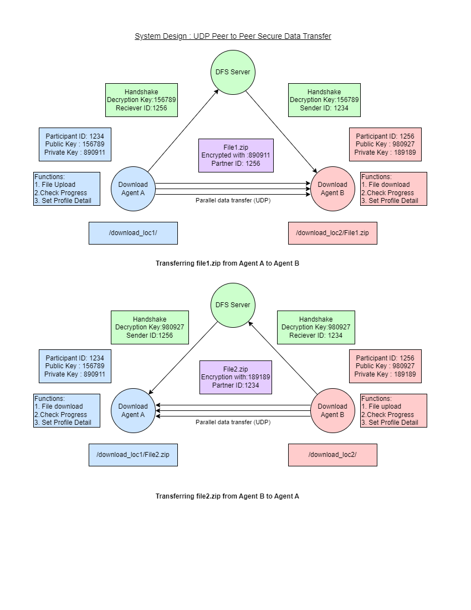
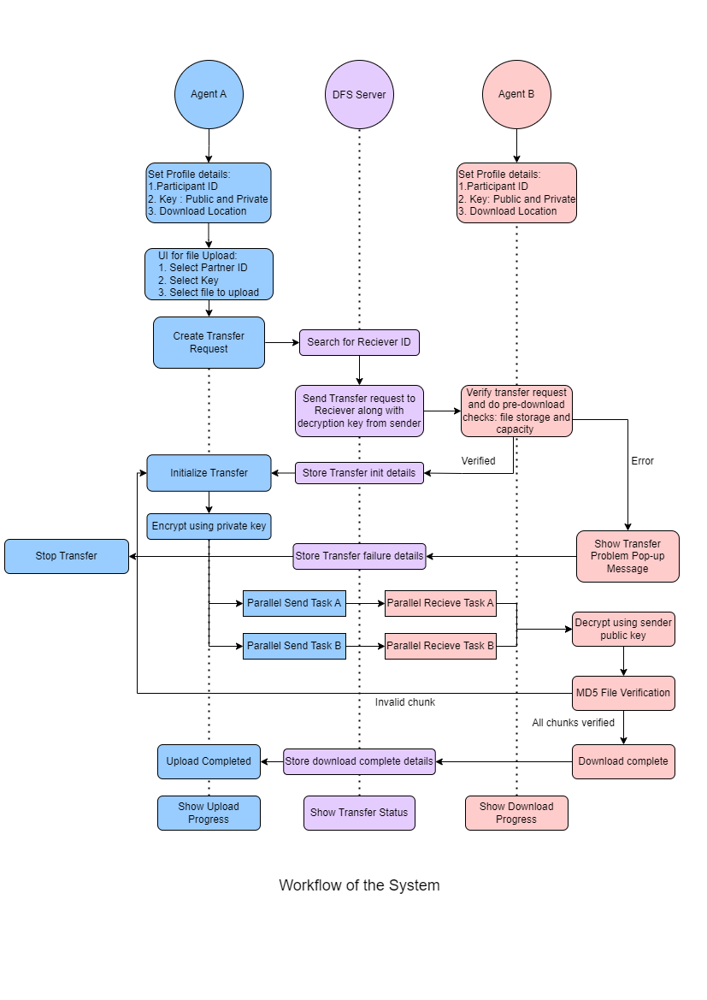

# Peer-to-Peer Secure Data Transfer

Encrypted, chunked, parallel file transfer between two Node.js agents, coordinated and logged by a central Data Foundation (DFS) server.


## Overview

The project lets two institutions ("agents") exchange large files directly with each other. A central **DFS server** handles discovery, request routing and an audit log, but it never carries file data.

- **Agent app** (`src/downloader`): an Express + EJS web app. The same codebase runs as the sender (port `3000`) and as the receiver (port `3001`). It splits files into parts, streams them to the peer encrypted with AES-256-CBC, and reassembles them on the other side. A worker pool downloads parts in parallel.
- **DFS server** (`src/dfs-server`): an Express service on port `4000`. It keeps the directory of agents (`users.csv`), passes transfer requests from sender to receiver, resolves agent addresses, and logs every event with Winston. It also has a small monitoring UI that shows the transfer history.

The original design (see `docs/` and the diagrams below) called for UDP for data and TCP for quality control. **The current implementation streams parts over Socket.IO (WebSocket/TCP)**, which is why the repository keeps its original "UDP" name.

## How it works

1. **Login.** The agent fetches the list of registered agents from the DFS server (`POST /login`, which returns bcrypt-hashed passwords) and authenticates the user locally with Passport.
2. **Upload request.** On the sender, the user browses the local file system, picks a file, enters the receiver's ID and a shared secret key, and submits.
3. **Partitioning.** The sender splits the file into parts of `PART_SIZE` (64 MB by default) under `tmp/<uuid>/` and records the transfer in its SQLite database.
4. **Routing.** The sender posts the transfer metadata to the DFS server (`/sender_request`). The DFS server looks up the receiver's address in `users.csv` and forwards the request to the receiver (`/dfs_request`).
5. **Accept or reject.** The request appears on the receiver's **Requests** page. The receiver's decision is reported back to the DFS server (`/accept_download`) and logged.
6. **Parallel download.** After accepting, the receiver gets the sender's address from the DFS server (`/get_address`). Worker threads then each open a Socket.IO connection to the sender and request one part (`request_part`). The sender streams the part through an AES-256-CBC cipher keyed with the shared secret, and the receiver decrypts it as it arrives.
7. **Merge.** When every part has arrived, the receiver merges them into `downloads/<filename>` and marks the transfer `COMPLETED`. Progress for each part is stored in SQLite, and the UI polls it.

### Original system design





## Features

- Web dashboard for each agent: configure, upload, incoming requests, ongoing transfers and completed downloads.
- Server-side directory browser for picking the file to send.
- Chunked transfer with parts streamed in parallel through a `workerpool` of threads.
- AES-256-CBC encryption of every part in transit, using a per-transfer secret key.
- Transfer state (status, parts received, progress) kept in SQLite via Sequelize, one database file per agent port.
- Accept/reject flow for incoming transfers, routed through the DFS server.
- DFS server audit log (Winston, JSON lines in `server.log`) with a **History** page showing the latest events.
- Jest + Supertest test suites for both services.

## Tech stack

| Area | Technology |
| --- | --- |
| Runtime | Node.js |
| Web | Express, EJS (`express-ejs-layouts`), Bootstrap, jQuery |
| Auth | Passport (local strategy), bcrypt, express-session |
| Transfer | Socket.IO, socket.io-stream, workerpool |
| Crypto | Node.js `crypto` (AES-256-CBC) |
| Storage | SQLite via Sequelize; CSV agent registry |
| Logging | Winston |
| Testing | Jest, Supertest |

## Project structure

```
UDP-Peer-to-Peer-Secure-Data-Transfer/
├── src/
│   ├── dfs-server/                # Central coordination + monitoring server (port 4000)
│   │   ├── app.js                 # Routes: /login, /sender_request, /get_address, /accept_download, /history
│   │   ├── users.csv              # Agent registry: id, password, name, key, address
│   │   ├── views/                 # Monitoring UI (index, history, current)
│   │   └── test/dfs.test.js
│   └── downloader/                # Agent app (sender on 3000, receiver on 3001)
│       ├── server.js              # Web UI, transfer orchestration, Socket.IO part server
│       ├── workers/streamWorker.js    # Worker: fetch + decrypt one part
│       ├── controllers/streamHandler.js  # Split file into parts / merge parts
│       ├── config/default.json    # PART_SIZE, TEMP_DIR, DOWNLOAD_DIR, workers, DFS_SERVER
│       ├── views/                 # Dashboard, upload, requests, transfers, downloads
│       └── tests/server.test.js
├── docs/                          # Project report (PDF) and presentation (PPTX)
└── README_ASSETS/Images/          # Design diagrams
```

## Getting started

### Prerequisites

- **Node.js 18 or 20.** The code uses `crypto.createCipher` / `createDecipher`, which were removed in Node.js 22.
- npm
- Build tools for the native `bcrypt` and `sqlite3` modules, if no prebuilt binaries exist for your platform.

### Install

```bash
git clone https://github.com/mkk96/UDP-Peer-to-Peer-Secure-Data-Transfer.git
cd UDP-Peer-to-Peer-Secure-Data-Transfer

cd src/dfs-server && npm install
cd ../downloader  && npm install
```

### Configure

- `src/dfs-server/users.csv` lists each agent's ID, password and `ip_address` (`host:port`). The defaults point to `localhost:3000` and `localhost:3001`.
- `src/downloader/config/default.json`: set `DFS_SERVER` to the DFS server's `host:port` (default `localhost:4000`). You can also tune `PART_SIZE`, `TEMP_DIR`, `DOWNLOAD_DIR` and the worker counts here.

### Run (three terminals)

```bash
# 1. DFS server: http://localhost:4000
cd src/dfs-server
npm run devstart          # or: node app.js

# 2. Sender agent: http://localhost:3000
cd src/downloader
npm run senderStart       # or: node server.js 3000

# 3. Receiver agent: http://localhost:3001
cd src/downloader
npm run receiverStart     # or: node server.js 3001
```

Start each agent from inside `src/downloader`. The config, worker script and SQLite files are resolved relative to the working directory.

### Test

```bash
cd src/dfs-server && npm test
cd src/downloader && npm test
```

## Usage

1. Open the sender at `http://localhost:3000/login` and sign in with one of the agent accounts defined in `users.csv`.
2. Open the receiver at `http://localhost:3001/login` and sign in with the other account.
3. On the sender, go to **Upload**, browse to a file, and enter the receiver's agent ID and a secret key.
4. On the receiver, open **Requests** and **Accept** the incoming transfer.
5. Watch progress under **Transfers**. The finished file appears under **Downloads** and in `src/downloader/downloads/`.
6. Open the DFS server at `http://localhost:4000` and click **History** to see the logged events.

## API reference

### DFS server (`:4000`)

| Method | Path | Purpose |
| --- | --- | --- |
| `GET` | `/` | Monitoring home |
| `GET` | `/history` | Last 20 log events, newest first |
| `GET` | `/current` | Placeholder ("Work in Progress") |
| `POST` | `/login` | Returns the agent list with bcrypt-hashed passwords |
| `POST` | `/sender_request` | `{ uuid, filename, size, parts, sender_id, receiver_id, secret_key }`. Forwards the request to the receiver |
| `POST` | `/get_address` | `{ id }`. Returns the agent's `ip_address` |
| `POST` | `/accept_download` | Logs the receiver's accept/reject decision |

### Agent (`:3000` / `:3001`)

| Method | Path | Purpose |
| --- | --- | --- |
| `GET` / `POST` | `/login` | Login page / Passport authentication |
| `GET` | `/upload`, `/dir?path=` | Upload page and directory listing |
| `POST` | `/upload` | Partition a file and send the transfer request to the DFS server |
| `POST` | `/dfs_request` | Incoming transfer request (called by the DFS server) |
| `GET` | `/requests`, `/transfers`, `/downloads` | Incoming requests, active transfers, completed files |
| `POST` | `/accept`, `/reject` | Respond to an incoming request |
| `GET` | `/progress` | JSON progress for active transfers |
| Socket.IO | `request_part` → `part` | Stream one encrypted part to a receiver |

## Limitations and future work

- Data travels over Socket.IO (TCP). The UDP data channel from the original design is not implemented.
- The design's per-chunk MD5 verification with NACK-based retransmission and its MinIO integration are not implemented.
- The secret key is typed by the sender and passed to the receiver through the DFS server. There is no public-key exchange.
- `crypto.createCipher` derives the key and IV from the password without a salt. A production version should switch to `createCipheriv` with a proper key derivation function.
- Agent accounts are kept in a CSV file, and the session secret is hard-coded. Both are fine for a demo but not for deployment.

## Context

Team project for **CS4.409 Data Foundation Systems** at IIIT Hyderabad (M.Tech, 2023), built by Soumodipta Bose, Vishal Pawar and Mukul Kumar. The full requirements, design and report are in `docs/`.

---

Made by [Mukul Kumar](https://mkk96.github.io) · [GitHub](https://github.com/mkk96) · [LinkedIn](https://www.linkedin.com/in/mukul-kumar-60322616b/)
